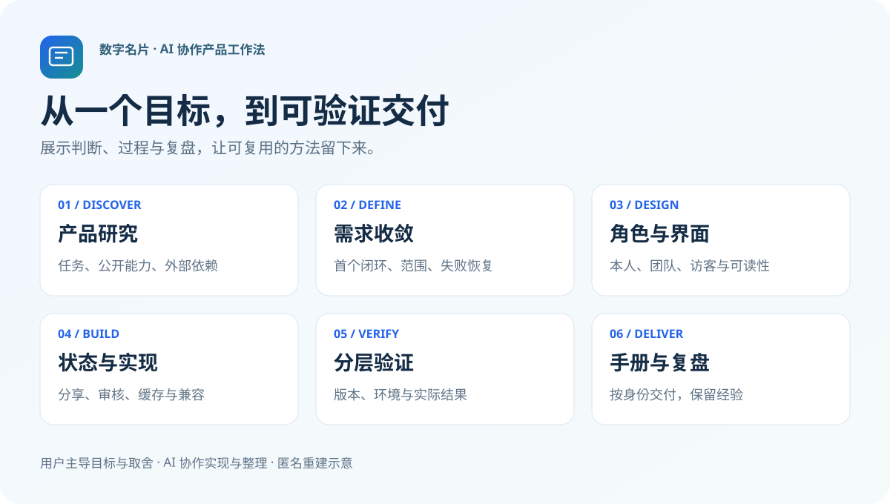

# 数字名片产品：从研究到交付的 Skill



一个由真实项目经验提炼、重新撰写的 **AI 协作产品工作法作品集**。从最初的参考产品研究和需求拆解，经过角色设计、界面方案、原生分享、兼容升级、验证与文档，沉淀为可复用的 Codex skill。

**我的工作：** 提出产品目标，确定使用者和场景，选择界面方案，反馈实际体验问题，推动范围取舍、隐私与交付标准。研究、实现、自动化和文档整理由 AI 协作完成。本作品不将 AI 生成代码描述为本人全部手写。

**公开范围：** 方法论、匿名复盘、原创通用示意图、模板和全新演示脚本。这里没有原公司的源码、Logo、人物、资料、聊天截图或部署信息；画面均为重新制作的示意。

## 从哪里看

| 想了解的内容 | 入口 |
| --- | --- |
| 最初如何从一个大目标拆出产品范围 | [产品研究到交付](docs/research-to-delivery.md) |
| 真实迭代中做了哪些判断、犯过哪些错 | [匿名项目案例](docs/case-study.md) |
| 安装并使用这套工作法 | [Skill 主入口](skills/card-product-workflow/SKILL.md) |
| 看作品展示图与流程卡片 | [静态作品页](index.html) · [流程总览](assets/process-overview.svg) |
| 理解本人、团队与访客之间的关系 | [通用架构图](assets/role-and-state-map.svg) |
| 看目标如何转成可验证的工作项 | [需求拆解示例](examples/discovery-brief.md) |
| 查看公开内容的边界与检查方法 | [发布边界](docs/publication-boundary.md) |

静态作品页没有后端、登录、统计脚本或真实二维码。可下载后直接打开 `index.html`；GitHub 中可先浏览 README 与 SVG 图。

## 这套 Skill 解决什么

- **需求太大：** 将参考产品拆成用户任务、独立设计、外部依赖和暂不实现的能力，维护早期原型与当前产品的边界。
- **身份太多：** 明确员工、管理员、所有者与访客各自可读、可写和可分享的资料。
- **分享状态混淆：** 区分请求成功、实际收件、头像审核、公开投影与再次转发，不靠自动重发掩盖不确定结果。
- **改版破坏旧数据：** 保留旧咨询原文，让新字段、编辑草稿与现有记录和平共存。
- **验证说得过满：** 将单测、浏览器、原生模拟器、真实设备、实际收件和平台版本核对分别记录。
- **交付说明落后：** 按角色组织手册，在相应动作旁说明设备差异，保留截图真实来源。

## 使用

将 `skills/card-product-workflow` 整个文件夹复制到你当前 Codex 环境使用的 skills 目录，保留其中的引用与模板。也可在有权访问该目录的任务中明确指定 `SKILL.md`。

示例请求：

```text
使用 $card-product-workflow。
我想做一个数字名片产品，先研究参考产品的公开能力，
再为员工、管理员和访客收敛首个业务闭环。
请给需求矩阵、角色边界和验证计划，不要复制品牌素材。
```

```text
使用 $card-product-workflow。
访客再次打开名片时偶尔看不到资料。
请先复现并画出读取、缓存和权限状态，再做针对性修复；
区分浏览器、模拟器与真实设备证据，别自动重复分享。
```

## 可直接复用的材料

- [研究目标卡](skills/card-product-workflow/assets/templates/discovery-brief.md)
- [需求与角色矩阵](skills/card-product-workflow/assets/templates/requirements-and-roles.md)
- [验证证据矩阵](skills/card-product-workflow/assets/templates/evidence-matrix.md)
- [版本交付回执](skills/card-product-workflow/assets/templates/release-receipt.md)
- [三种身份手册大纲](skills/card-product-workflow/assets/templates/role-guide-outline.md)

## 本地检查

仅需 Python 标准库和 Git；skill 格式校验可使用创建 skill 时的验证工具。

```bash
python -m unittest discover -s tests -v
python skills/card-product-workflow/scripts/check_evidence.py examples/partial-evidence.json
python scripts/audit_public_package.py --root . --manifest publication-manifest.json --git-history
```

证据示例会返回“尚未具备真实发布条件”，这是刻意保留的演示结果。检查工具校验的是结构和证据范围，不替代实际测试，也不保证发现所有敏感内容。

本仓库的可展示成果是 **可执行的方法、状态模型、复盘与交付模板**；不以未核实的上线状态、用户量、收入或性能数字作为宣传。

## 内容归属

仅展示独立撰写的方法论与演示材料。未在这里发布原业务产品或授权其素材。仓库目前未额外指定开源许可，公开展示与产品源码开源是不同的事情，见 [内容说明](NOTICE.md)。
